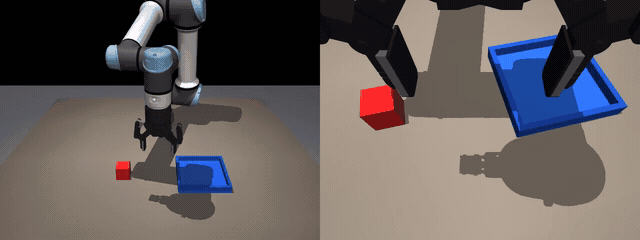

# ur5e-lerobot

UR5e pick-and-place policies on LeRobot, currently with pi0.5.

UR5e with a Robotiq 2F-85 or OnRobot RG2 gripper, RealSense D455 or D435i (front, external) and D405
(wrist) cameras and a 3Dconnexion SpaceMouse. LeRobot 0.7.0, locked with Pixi: setup/calibration → SpaceMouse collection →
fresh-base LoRA training with automatic train-only stats → supervised RTC rollout.
Full datasets, checkpoints and machine configuration stay local; Hub uploads are disabled.

## Prerequisites

**[Pixi](https://pixi.sh).** Pixi installs everything else (Python, PyTorch, CUDA libraries, LeRobot) from
`pixi.lock`; no system Python, Conda, ROS or CUDA toolkit is needed. Pixi 0.83.0 is the
tested version ([installation guide](https://pixi.sh/latest/installation/)):

```sh
curl -fsSL https://pixi.sh/install.sh | PIXI_VERSION=0.83.0 bash
git clone https://github.com/weijieyong/ur5e-lerobot.git
cd ur5e-lerobot
pixi run --locked setup   # installs the environment and creates config/local/machine.env
pixi run --locked test    # offline; no hardware
```

Tested on Ubuntu 22.04 (robot PC and training machine: full workflow). `pixi run smoke-docker`
additionally checks a clean install and the offline tests in an Ubuntu 24.04 container.

**Robot PC (teleop, recording, inference).** x86-64 with an X11 desktop and an NVIDIA
driver supporting CUDA 12.9.

| | Recommended | Notes |
| --- | --- | --- |
| GPU | 24 GB VRAM (e.g. RTX 4090) | Rollout peaks at about 8.9 GiB, so a 10 GB RTX 3080 works with little headroom. |
| Disk | 50 GB+ free | Environment about 13 GB, plus model weights, datasets and outputs. |
| Hardware | UR5e in Remote Control, gripper URCap, D455 or D435i + D405 on USB 3, SpaceMouse | See the [operating guide](docs/operating-guide.md). |

**Training machine.** Can be the robot PC if it has the GPU memory.

| | Recommended | Notes |
| --- | --- | --- |
| GPU | Minimum 1× RTX 6000 Ada (48 GB); tested on 2× | Default: one idle GPU, batch 8, 30000 updates. An optional two-GPU recipe uses batch 4 per GPU. See the training guide for `train-check`. |
| Disk | 100 GB+ free | Base model, datasets and checkpoints. |

> [!IMPORTANT]
> Training needs the PaliGemma tokenizer, which is gated: use a Hugging Face account that has
> accepted the Gemma license. See [model downloads](docs/training.md#model-downloads).

Terms such as READY, floor, workspace and action chunk are defined in the [glossary](GLOSSARY.md).

## Workflow

> [!WARNING]
> These commands move a real robot. Run them only with an operator at the robot, a clear
> workspace and the pendant e-stop in reach. Example config values are not safe defaults:
> measure IP, devices, home, TCP, floor and neutral for your setup first.

1. Follow the [operating guide](docs/operating-guide.md) for prerequisites, measured
   configuration, camera checks, teleoperation and collection.
2. Follow [training and deployment](docs/training.md) to train a finalized dataset with the
   reference schedule and copy complete assets for rollout. Use `pixi run plot-training`
   to [plot training results](docs/training.md#plot-training-results) and inspect saved checkpoints.
3. Return to the operating guide for supervised rollout and outcome recording.

## Simulation

The experimental MuJoCo environment uses the same LeRobot v3 recording and pi0.5 LoRA
training pipeline. See the [simulation guide](docs/simulation-scope.md) for commands and limits.
It uses a fixed layout and does not qualify a policy for real hardware.

Run `pixi run sim-laser-trace` to preview the [scripted laser line trace](docs/simulation-scope.md#laser-line-trace).

The pick-and-place recordings below show the front camera on the left and wrist camera on the right.
Click either animated preview to open its full-resolution MP4. Playback follows the saved
dataset timestamps, not wall-clock inference timing.

### Scripted teacher: data collection

The first collection episode: the scripted teacher picks up the cube and places it in the
tray while LeRobot records the demonstration. This is scripted control, not a learned policy.

[](docs/media/simulation/teacher.mp4)

### Learned policy: RTC rollout

The first evaluation attempt after 1,000 action-expert LoRA updates on 10 fixed-layout teacher
episodes. The trained policy runs without the teacher but fails to complete the task;
the pilot scored **0/5 successful attempts**. This shows the rollout pipeline, not a successful policy.

[](docs/media/simulation/learned-rollout.mp4)

The renderings use the bundled [MuJoCo Menagerie assets](src/lerobot_robot_ur5e/lerobot_robot_ur5e/sim/assets/PROVENANCE.md).

## Verification

Offline tests establish software behavior only.
Clean installation, GPU training/save/strict reload and supervised physical
qualification remain separate acceptance gates for each deployment.

`pixi run lint` and `pixi run test` are offline checks; neither touches hardware.
The suite covers safety gates, recording integrity, configuration preservation and training/rollout
integration, including RTC prediction and runtime contracts against the pinned LeRobot version.

## License

The code in this repository is licensed under the [Apache License 2.0](LICENSE).
Models, tokenizers and datasets are not covered: pi0.5 and PaliGemma weights carry
their own licenses, so review their upstream terms before redistributing them.
